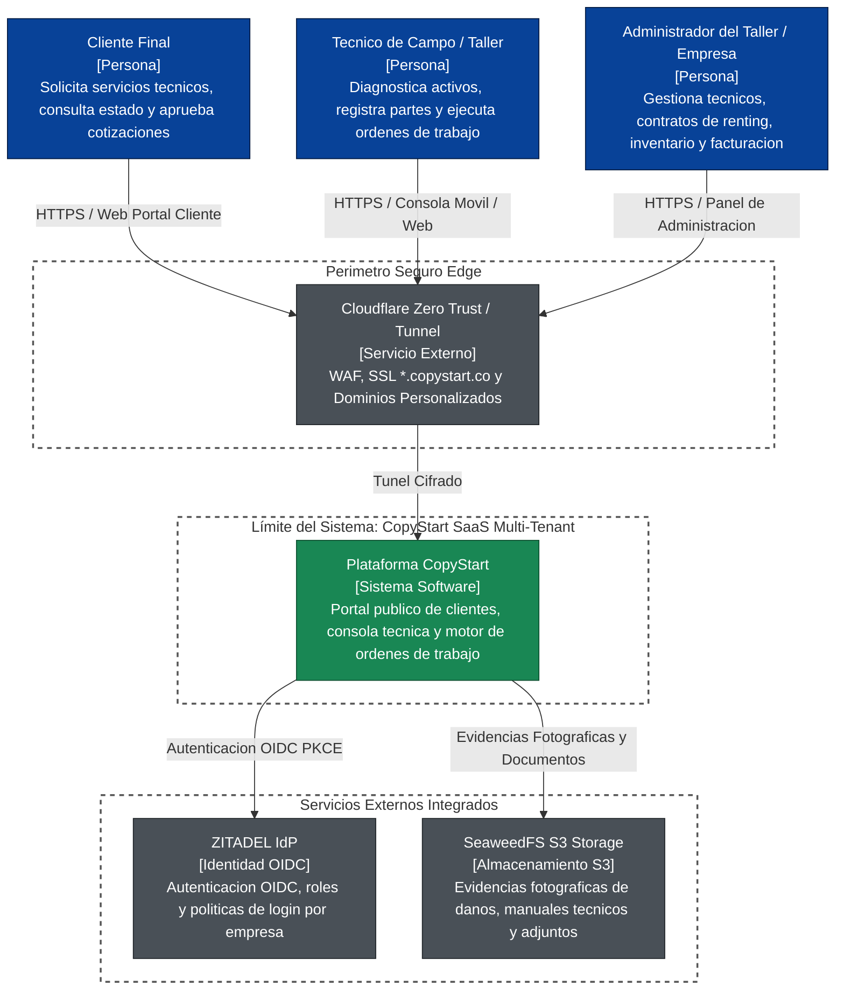
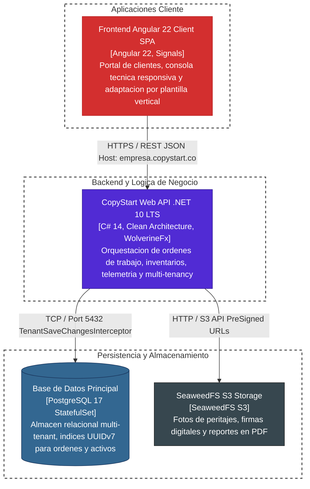
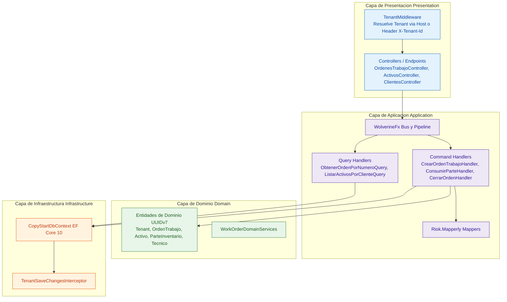

# 🏛️ Modelo C4 & Arquitectura del Sistema (CopyStart)

Este documento define la arquitectura formal del sistema **CopyStart SaaS**, utilizando el **Modelo C4** diagramado mediante Mermaid Flowchart estándar con clases declarativas `classDef` universalmente compatibles.

---

## 1. Nivel 1: Diagrama de Contexto del Sistema (System Context)

---

## 2. Nivel 2: Diagrama de Contenedores (Container Diagram)

---

## 3. Nivel 3: Diagrama de Componentes (Component Diagram - CopyStart API)

